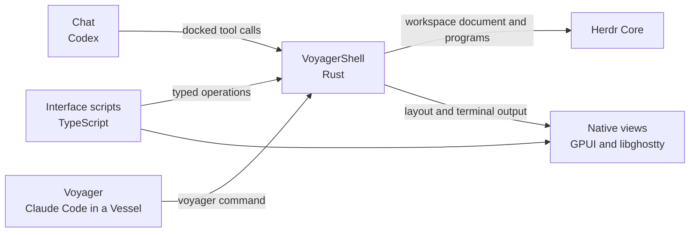

# VoyagerShell

VoyagerShell is a canvas where people and agents work together. It is a Linux
desktop app. A panel can hold a terminal, a coding agent or content of a type
that you declare in a JSON file. Drag the Voyager avatar onto a panel, a tab or a
whole space, and that is what it can see and change.

VoyagerShell 0.1 is an early release for a small group of users. Build it from
source.

## Docking

The workspace has four kinds of place. A **Voyage** is a space for one project.
A **Fleet** is a tab in a Voyage. A **Vessel** is one piece of content, such as a
terminal or a coding agent, of a Vessel type. A Vessel sits in a Fleet. A
**Portal** is a Vessel that stays on screen across every Fleet in its Voyage.

The **Voyager avatar** is the assistant you dock. Drag it onto any of those
places to dock it there. The status bar shows the dock, such as **Voyager / Terminal 1** for
a Portal in the Voyage named Voyager. **Overwatch** means the whole workspace.
For example, dock on the terminal where a test failed and ask why it failed.

Docking sets what the Voyager avatar can see and change. It never moves your
keyboard focus or limits your own clicks. A request keeps the context it was
sent with, so docking somewhere else never changes a request already sent.

## What you can do

- **Run terminals and coding agents in panels.** Shells, Codex, Claude Code and
  other agent programs run in [Herdr Core](https://github.com/herdrdev/herdr-core),
  so they keep running after you quit the app.
- **Arrange your work.** Add Voyages, Fleets, Vessels and Portals. Split,
  resize and maximize any panel.
- **Talk to Voyager.** Click the avatar's voice control and speak. Voyager is a
  Claude Code session that the app starts in a Portal on Home. It reads where
  the avatar is docked with every prompt, acts through the `voyager` command
  and its reply is read aloud. Speech is heard and spoken by a local model, so
  no audio goes to a cloud service. Another click turns voice off.
- **Chat with the avatar.** The chat panel is a private Codex conversation. It
  can arrange panels, read and type into terminals and create Git worktrees,
  only where you dock it. It does not edit your code. Coding agents in panels
  do that.
- **Make your own Vessel type.** Write a JSON manifest in your profile that
  declares the type's state and actions. No build or restart is needed. The app checks it while it runs and
  lists every problem it finds. A broken edit keeps the last version that
  worked. [Make a Vessel type](docs/voyager-command.md#make-a-vessel-type)
  shows how.
- **Let agents arrange the workspace.** An agent in a Vessel runs the
  `voyager` command to read the workspace, add Fleets and Vessels and move
  them. `voyager --skill` prints its guide.
- **Change the interface while it runs.** The interface is TypeScript compiled
  to JavaScript. The app copies that JavaScript into your profile. Edit a file
  there and the view reloads. A broken edit shows its error and keeps the last
  working view.
- **Quit and pick up where you left off.** Your programs keep running in Herdr
  Core after **Ctrl+Q**. Reopen the app and your layout and live terminals come
  back. After a reboot, terminals reopen as new shells.

## Build and run

VoyagerShell runs on Linux. It is tested on X11 and also builds for Wayland.
macOS and Windows are not supported.

You need Git, Python 3, Node.js 24, Rust, Zig 0.17, a working Vulkan driver,
and the GPUI native libraries for X11 or Wayland. Install
[Herdr Core](https://github.com/herdrdev/herdr-core) so that `hc` is on
`PATH`. VoyagerShell's Core API is generated from Core 0.1.18, the oldest release
it supports, and CI tests against Core 0.1.21.

The assistant and voice need more:

- Claude Code for Voyager, which the app starts on launch.
- Codex for the chat panel.
- For voice, `llama-server`, the local Omni model files, and `parec` and
  `paplay` from the `pulseaudio-utils` package. [Set up voice](#set-up-voice)
  shows how to install them.

Shells need none of these.

Build from the repository root:

```sh
python3 desktop/prepare-sdk.py
npm ci --ignore-scripts
cargo build --release --locked -p voyager-desktop -p voyager-app --bin voyager-shell --bin voyager
```

Start the app from the project you want to work in. The first Voyage and its
terminals open in that directory:

```sh
cd ~/your-project
/path/to/voyagershell/target/release/voyager-shell \
	--profile "$HOME/.local/share/voyagershell" \
	--session voyager-main
```

Both flags are required. `--profile` is an absolute path to the folder that
holds your interface scripts, theme and settings. `--session` names your Herdr
Core session. It starts with `voyager-` and uses lowercase letters, digits and
hyphens.

Quit with **Ctrl+Q**. The window's close button quits the same way. Both keep
your programs running in Herdr Core.

To learn the app by using it, follow the tutorial,
[Learn VoyagerShell by running it](docs/README.md). It walks through every
part of the workspace and traces one click through the code.

## Set up voice

Voice runs on LiquidAI's LFM3 Omni model through llama.cpp's `llama-server`, on
your own computer. In 0.1 you install both by hand. Codex voice isn't available
in 0.1. LiquidAI's licence for the model applies to your use of it, so read it
on the model's Hugging Face page before you download.

The app looks for voice files in `~/.cache/voyager/voice/omni/`, the voice
folder. If `XDG_CACHE_HOME` is set to an absolute path, the voice folder is
`$XDG_CACHE_HOME/voyager/voice/omni/` instead. Voice also needs `parec` and
`paplay` from the `pulseaudio-utils` package.

1. Get `llama-server` from llama.cpp, build b12242 or newer. Pick the kind of
	build by where you want the model to run. A CPU-only build always runs the
	model on the processor, and the graphics card setting in step 3 does
	nothing with it. To use a graphics card, get a GPU build.
	- For an NVIDIA graphics card, get a CUDA build, from the llama.cpp release
		page or built from source. The release page's CUDA builds may also need
		its matching CUDA runtime bundle. To build from source, run:

		```sh
		cmake -B build -DGGML_CUDA=ON
		cmake --build build --config Release
		```

	- For another graphics card, download a llama.cpp release build for Linux
		that uses Vulkan.
	- Without a graphics card, download a llama.cpp CPU release build for Linux.

	Copy `llama-server` and the libraries that come with it into the voice
	folder. To leave a build where it is, set `VOYAGER_OMNI_SERVER` to the full
	path of its `llama-server` instead.
2. Download `LFM3-Omni-2B-Q4_K_M.gguf` and `mmproj-LFM3-Omni-2B-Q4_K_M.gguf`
	from [LiquidAI/LFM3-Omni-2B-GGUF](https://huggingface.co/LiquidAI/LFM3-Omni-2B-GGUF)
	on Hugging Face. Put both files in the voice folder. The app also finds them
	in the Hugging Face cache, so files that the Hugging Face command-line tool
	downloaded can stay where they are.
3. To run the model on your graphics card with a GPU build from step 1, start
	the app with `VOYAGER_OMNI_GPU_LAYERS=999` set. The default, 0, runs the
	model on the processor.

	```sh
	VOYAGER_OMNI_GPU_LAYERS=999 /path/to/voyagershell/target/release/voyager-shell \
		--profile "$HOME/.local/share/voyagershell" \
		--session voyager-main
	```

4. Start the app and click the avatar's voice control. The app looks for the
	voice files once, when it starts. If a file is missing, the voice control
	stays off. Hold the pointer over it to see "Local voice is not installed"
	and the missing parts. Add the missing files, then restart the app.

[Local voice](docs/voice.md) explains how hearing and speaking work. [Where the
files are found](docs/voice.md#where-the-files-are-found) lists every voice
setting.

## How it works



Herdr Core owns programs, terminals and the saved workspace document.
VoyagerShell's Rust application owns placement, content and the dock. Your
clicks, the chat's tool calls and the `voyager` command run the same Rust
operations. The app also checks each chat tool call against where the avatar
is docked. One contract,
written in Rust, generates the TypeScript types and validators that the
interface uses.

| Directory              | Contents                                                                  |
| ---------------------- | ------------------------------------------------------------------------- |
| [contract/](contract/) | Shared operations, identities and results, with generated types.          |
| [app/](app/)           | Workspace, content and dock owners, plus the Core and Codex connectors.   |
| [desktop/](desktop/)   | Native views, the terminal, the Voyager avatar and the interface scripts. |
| [content/](content/)   | Built-in Vessel type manifests, agent programs and shared controls.       |
| [tests/](tests/)       | The native verification environment and the architecture checks.          |

## Documentation

- [Learn VoyagerShell by running it](docs/README.md) is the hands-on tutorial.
- [The voyager command](docs/voyager-command.md) is the guide for agents in
  Vessels, including how to make a Vessel type. `voyager --skill` prints it.
- [Glossary](docs/glossary.md) defines Voyage, Fleet, Vessel, Portal and the
  other words the app uses.

Design notes for contributors:

- [Workspace](docs/workspace.md) covers placement, layouts and script
  authoring.
- [Terminal](docs/terminal.md) covers input, scrolling and program lifetime.
- [Agent launch](docs/agent-launch.md) covers `launches.json`, which adds
  agents beyond Codex and Claude Code.
- [Vessel types and content](docs/content.md) covers Vessel types and their data.
- [Local voice](docs/voice.md) covers hearing, speaking and the local model.
- [Private conversation](docs/conversation.md) covers the chat and its tools.
- [Avatar](docs/avatar.md) covers docking and motion.
- [Inspection](docs/inspection.md) covers the `--inspect` report of where
  controls are on screen.
- [Feature map](docs/features.md) lists each feature and the checks that
  prove it.

## Contributing

Read [CONTRIBUTING.md](CONTRIBUTING.md) for the checks every change passes and
[CONSTRAINTS.md](CONSTRAINTS.md) for the review rules. Agents start with
[AGENTS.md](AGENTS.md). Every pull request runs the checks in GitHub Actions.

## License

[MIT](LICENSE). Herdr Core is an external dependency. Upstream components and
artwork keep their own licenses and attribution.
