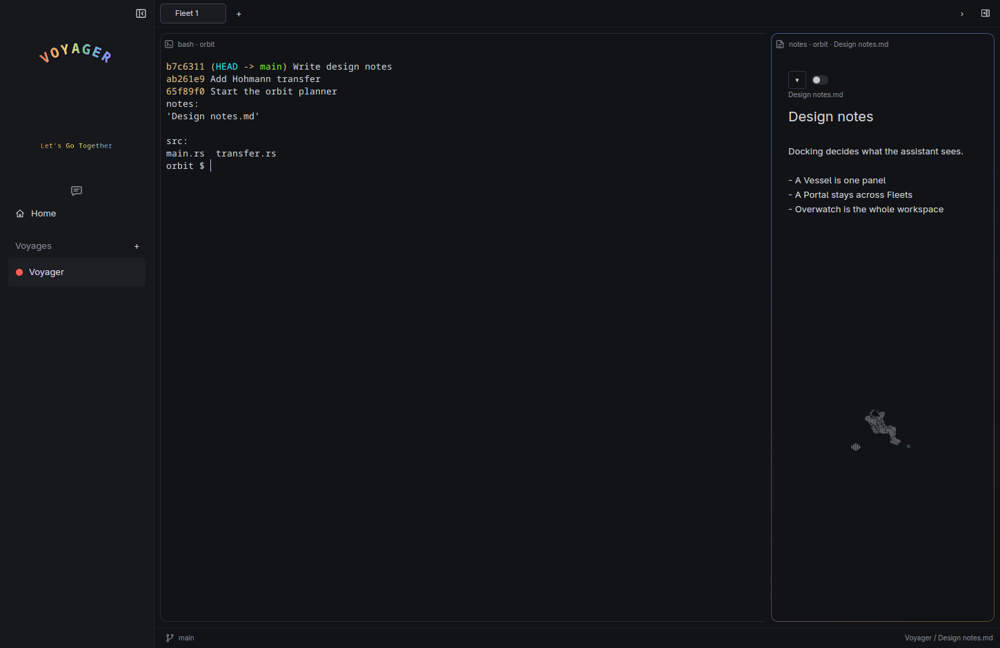
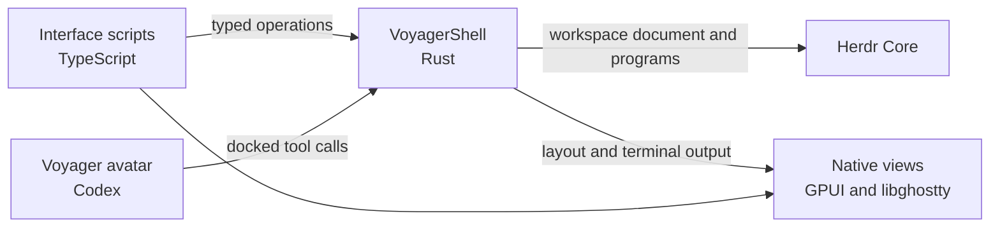

# VoyagerShell

VoyagerShell is a canvas for agents and humans to collaborate. It is a Linux
desktop app for terminals, coding agents and Markdown notes. Drag the Voyager
avatar onto a panel, a tab or a whole space, and that is what it can see and
change.



There are no releases yet. Build from source.

## Docking

The workspace has four kinds of place. A **Voyage** is a space for one project.
A **Fleet** is a tab in a Voyage. A **Vessel** is a panel in a Fleet. A
**Portal** is a panel that stays on screen across every Fleet in its Voyage.

The **Voyager avatar** is the assistant you dock. Drag it onto any of those
places to dock it there. The status bar shows the dock, such as **Voyager / Design notes.md** for
a Portal in the Voyage named Voyager. **Overwatch** means the whole workspace.
For example, dock on the terminal where a test failed and ask why it failed.

Docking sets what the Voyager avatar can see and change. It never moves your
keyboard focus or limits your own clicks. A request keeps the context it was
sent with, so docking somewhere else never changes a request already sent.

## What you can do

- **Run terminals and coding agents in panels.** Shells, Codex and Claude Code
  run in [Herdr Core](https://github.com/herdrdev/herdr-core), so they keep
  running after you quit the app.
- **Arrange your work.** Add Voyages, Fleets, Vessels and Portals. Split,
  resize and maximize any panel.
- **Keep notes beside the work.** Notes edits and previews Markdown and saves
  each note as a file in the project's `notes/` folder.
- **Ask the Voyager avatar.** It runs on Codex. It can arrange panels, read and type
  into terminals, read and write notes, and create Git worktrees, only where you
  dock it. It does not edit your code. Coding agents in panels do that.
- **Change the interface while it runs.** The interface is TypeScript compiled
  to JavaScript. The app copies that JavaScript into your profile. Edit a file
  there and the view reloads. A broken edit shows its error and keeps the last
  working view.
- **Quit and pick up where you left off.** Your programs keep running in Herdr
  Core after **Ctrl+Q**. Reopen the app and your layout, notes and live
  terminals come back. After a reboot, terminals reopen as new shells.

## Build and run

VoyagerShell runs on Linux. It is tested on X11 and also builds for Wayland.
macOS and Windows are not supported.

You need Git, Python 3, Node.js 24, Rust, Zig 0.17, a working Vulkan driver,
and the GPUI native libraries for X11 or Wayland. Install
[Herdr Core](https://github.com/herdrdev/herdr-core) so that `hc` is on
`PATH`. VoyagerShell's Core API is generated from Core 0.1.18, the oldest release
it supports, and CI tests against Core 0.1.21. Install Codex to use the Voyager avatar, and Claude Code for a
Claude panel. Shells and Notes need neither.

Build from the repository root:

```sh
python3 desktop/prepare-sdk.py
npm ci --ignore-scripts
cargo build --release --locked -p voyager-desktop --bin voyager-shell
```

Start the app from the project you want to work in. The first Voyage opens in
that directory, and Notes saves files there:

```sh
cd ~/your-project
/path/to/voyagershell/target/release/voyager-shell \
	--profile "$HOME/.local/share/voyagershell" \
	--session voyager-main
```

Both flags are required. `--profile` is an absolute path to the folder that
holds your interface scripts, theme and settings. `--session` names your Herdr
Core session. It starts with `voyager-` and uses lowercase letters, digits and
hyphens.

Quit with **Ctrl+Q**. Closing the window leaves the Voyager avatar floating on the
desktop.

To learn the app by using it, follow the tutorial,
[Learn VoyagerShell by running it](docs/README.md). It walks through every
part of the workspace and traces one click through the code.

## How it works



Herdr Core owns programs, terminals and the saved workspace document.
VoyagerShell's Rust application owns placement, content and the dock. Your
clicks and the Voyager avatar's tool calls run the same Rust operations. The
app also checks each of its tool calls against where it is docked. One contract,
written in Rust, generates the TypeScript types and validators that the
interface uses.

| Directory              | Contents                                                                  |
| ---------------------- | ------------------------------------------------------------------------- |
| [contract/](contract/) | Shared operations, identities and results, with generated types.          |
| [app/](app/)           | Workspace, content and dock owners, plus the Core and Codex connectors.   |
| [desktop/](desktop/)   | Native views, the terminal, the Voyager avatar and the interface scripts. |
| [content/](content/)   | Content packages that ship with the app, such as Notes.                   |
| [tests/](tests/)       | The native verification environment and the architecture checks.          |

## Documentation

- [Learn VoyagerShell by running it](docs/README.md) is the hands-on tutorial.

Design notes for contributors:

- [Workspace](docs/workspace.md) covers placement, layouts and script
  authoring.
- [Terminal](docs/terminal.md) covers input, scrolling and program lifetime.
- [Agent launch](docs/agent-launch.md) covers `launches.json`, which adds
  agents beyond Codex and Claude Code.
- [Notes and content](docs/content.md) covers content types and their data.
- [Private conversation](docs/conversation.md) covers the Voyager avatar's conversation and its
  tools.
- [Avatar](docs/avatar.md) covers docking and motion.
- [Inspection](docs/inspection.md) covers the `--inspect` report of where
  controls are on screen.

## Contributing

Read [CONTRIBUTING.md](CONTRIBUTING.md) for the checks every change passes and
[CONSTRAINTS.md](CONSTRAINTS.md) for the review rules. Agents start with
[AGENTS.md](AGENTS.md). Every pull request runs the checks in GitHub Actions.

## License

[MIT](LICENSE). Herdr Core is an external dependency. Upstream components and
artwork keep their own licenses and attribution.
